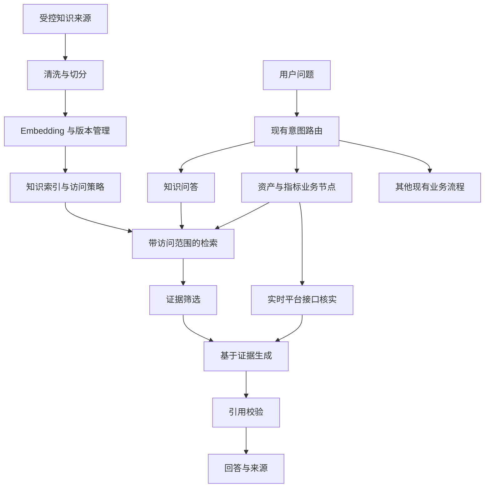

# Data Agent RAG 知识检索增强 PRD

| 项目 | 内容 |
| --- | --- |
| 文档版本 | v1.0 |
| 状态 | Draft，待评审 |
| 日期 | 2026-10-10 |
| 所属产品 | Data Agent 数据平台智能助手 |
| 关联需求 | [Data Agent PRD v2.0](prd_v2.md) |
| 本次交付 | RAG 需求与接入设计，不代表功能已实现 |

## 1. 产品概述

为 Data Agent 增加企业知识检索与基于证据的回答能力，使用户能够通过自然语言获取平台操作指南、数据资产说明、指标口径及 SQL 使用案例，并追溯答案来源。沿用现有 LangGraph 编排、平台工具、权限校验和人工确认流程。

产品采用“知识检索提供背景与候选，平台接口提供实时事实”的原则。首期上线平台知识问答及引用展示，后续增强找表、指标解释与 SQL 辅助。

RAG 指在回答时检索外部知识，并将相关证据提供给模型生成答案；仅增加向量检索不构成完整的 RAG 回答能力。

## 2. 背景与现状

### 2.1 当前能力

- `nodes.py` 已有资产发现、表与字段解释、指标解释、权限申请和 SQL 辅助等业务节点。
- `discover_assets` 通过 `search_data_assets` 搜索，再调用权限与推荐工具。
- `explain_table` 查询表元数据与血缘；业务回答主要由 `formatting.py` 格式化生成。
- `routing.py` 中的可选 LLM 用于意图识别，失败时回退规则路由。
- `ToolRegistry` 统一管理平台工具与审计，并校验适配器必须实现的工具集合。
- 当前代码未建立独立的文档入库、Embedding、向量索引及带引用回答流程。

### 2.2 待解决问题

1. 业务术语与物理表名不一致，仅依赖现有资产搜索难以覆盖语义表达。
2. 操作指南、指标说明和使用经验分散在文档中，无法直接用于回答。
3. 缺少可追溯的文档引用，用户难以核实解释依据。
4. 仅凭历史文档可能产生过期口径或错误操作建议，需要与实时平台事实协调。

## 3. 用户与场景

| 用户 | 问题示例 | 期望结果 |
| --- | --- | --- |
| 数据分析师 | “统计各地区销售额应该用哪张表？” | 推荐候选表、解释适用粒度，附文档依据和实时权限状态 |
| 业务分析师 | “GMV 是否包含退款？” | 明确口径、适用版本和来源；存在歧义时询问业务域或时间 |
| 平台用户 | “生产环境查询权限怎么申请？” | 返回有依据的操作步骤；实际申请进入已有确认流程 |
| 数据研发 | “有没有按天汇总订单的 SQL 示例？” | 返回已审核示例及适用条件，不自动执行 |
| 知识管理员 | “这份操作指南已更新或撤回。” | 更新或移除索引内容，避免继续引用旧内容 |

## 4. 目标与范围

### 4.1 产品目标

- 用户能够获得有明确依据、可点击追溯的知识回答。
- 无依据、歧义或资料冲突时明确说明，不编造确定结论。
- 检索与生成严格遵守文档阅读权限和租户边界。
- RAG 可配置启停，关闭后原有功能继续工作。
- 检索、模型或索引异常时提供可理解的降级结果。

### 4.2 分期范围

| 阶段 | 必须交付 | 用户价值 |
| --- | --- | --- |
| P0：知识问答 MVP | 受控 Markdown/TXT 入库、更新删除、权限过滤、知识问答路由、检索、生成、引用、评测 | 能查询平台指南与 FAQ，并验证出处 |
| P1：业务增强 | 表/指标元数据同步、混合检索、找表与指标解释节点集成、实时事实核实 | 能用业务语言定位数据资产和理解口径 |
| P2：SQL 知识辅助 | 审核 SQL 示例库、方言与版本过滤、SQL 节点集成 | 能复用可靠示例，减少重复编写与排查 |

P0 的候选召回可以先使用向量检索加标识符精确匹配；P1 完成关键词与向量结果融合。重排序模型根据评测收益决定是否加入，不作为 P0 前置条件。

切分参数、两路召回权重和重排序阈值均为待评测参数，不在开发前固定为通用常数。宽泛业务问题的范围识别与证据门控纳入 P0；否则知识问答即使检索命中，也可能生成无关的通用解释。

### 4.3 本期不包含

- 自动执行文档或模型建议中的 SQL、授权、工单提交或 DAG 发布。
- 将全量业务明细、查询结果、会话记录或审计日志默认导入知识库。
- 任意网站抓取、扫描整个仓库入库、PDF OCR 和复杂表格解析。
- 自主多轮研究 Agent、模型微调或独立知识管理前端。
- 替换现有平台接口、权限中心或人工确认机制。

## 5. 用户体验与回答约定

### 5.1 标准流程

1. 用户提出知识问题，路由到 `knowledge_qa`。
2. 服务端解析可信身份和文档访问范围。
3. 检索可见且有效的内容，判断证据是否足够。
4. 模型仅依据提供的证据生成回答及引用 ID。
5. 程序验证引用 ID，映射到真实来源；向用户返回回答、引用与必要的更新时间。

示例展示格式：

> 根据《生产环境权限申请指南》的当前版本，申请需选择资源、角色和有效期，并提交审批。[1]
>
> 来源：[1] 生产环境权限申请指南 · 权限申请章节 · 更新日期：YYYY-MM-DD
>
> 如需实际提交申请，请进入权限申请流程。

以上仅为展示示例，具体申请规则必须来自实际入库资料与平台接口。

### 5.2 回答状态

| 状态 | 触发条件 | 用户行为 |
| --- | --- | --- |
| `answered` | 证据足够且引用合法 | 展示答案与来源 |
| `needs_clarification` | 业务域、对象或版本不明确 | 询问最少必要条件 |
| `insufficient_evidence` | 无相关证据或证据不足 | 告知未找到足够依据，提供可行的补充方向 |
| `conflicting_evidence` | 有效资料对同一事实存在冲突 | 展示用户有权查看的冲突依据，避免强行合并结论 |
| `unavailable` | 检索或生成服务不可用 | 告知知识问答暂不可用，保留其他业务能力 |

不得通过“无权限文档数量”、标题或摘要暴露用户不可见的资料。对用户统一表现为未找到可用依据。

### 5.3 宽泛业务问题的范围约束

用户可能问“销售情况怎么样”“客户价值是什么”“怎么提升转化率”一类宽泛问题。系统先识别业务域、分析对象、指标口径、时间范围、环境以及用户期望的动作。缺少影响答案正确性的关键限定时，仅基于已知的企业资料给出可确认的范围，并询问一个最关键的补充条件；不能把“销售”自动扩展成全网营销知识或未经授权的数据结论。

示例：

| 用户问题 | 期望处理 |
| --- | --- |
| “销售情况怎么样？” | 若业务域、指标和时间均不明，询问“想看哪个业务域、哪段时间的销售指标？”；不生成行业趋势或增长建议 |
| “我们 GMV 为什么下降？” | 先明确时间对比和已授权指标；无实时查询结果时仅说明已有口径及可查询路径，不编造下降原因 |
| “客户价值怎么算？” | 检索企业内部指标定义；有多个业务域口径时列出差异并请求选择，不套用通用 LTV 公式作为企业标准 |
| “帮我查订单转化率” | 识别为数据查询或指标任务，沿用权限检查与只读查询流程；知识库只能辅助定位口径 |

生成回答时执行“问题范围 → 可用证据 → 允许作出的结论”检查：每个业务断言应有本轮可见的企业证据或权威平台结果支持。低相关或仅能支持一般概念的资料不能使回答状态变为 `answered`。可以展示明确标注为一般概念的简短解释，但不能将其表述为本企业事实，也不能作为业务结论或操作建议。模型的已有知识仅用于组织语言，不用于补足事实。输出必须区分“已确认事实”“待确认条件”和“建议下一步”。

## 6. 功能需求

### FR-01：受控知识入库（P0）

- 通过显式配置的文件清单或受控目录导入 UTF-8 Markdown/TXT。
- 入库必须指定知识库、来源标识、阅读权限和版本；缺失访问策略时拒绝发布。
- 默认不遍历项目 `docs` 全目录，避免把无关文件或个人资料纳入知识库。
- 按标题、段落和业务对象切分，保留章节路径；不得将相邻无关文档拼接成同一片段。
- 表定义、指标公式、完整 SQL 示例优先保持语义完整，超长内容采用父文档与子片段关联。
- 切分以业务语义为边界：Markdown 按标题/小节，FAQ 按问答对，表/指标按规范对象，SQL 按完整语句与说明；禁止把公式、限定条件、适用范围或示例 SQL 切散后单独引用。
- 默认先生成不重叠的语义片段；仅在段落或句子跨边界且离线评测显示召回受损时，加入小范围 overlap。重叠应避免整段重复，结果中相邻片段须合并或去重，防止同一文档挤占 Top-K。
- 若知识来源是 Git/代码变更，diff hunk 可作为定位变更的输入单位，但不能直接作为最终检索片段：需补充函数、章节或配置项上下文，再按语义切分。普通业务文档使用 chunk，不以 diff hunk 为切分单位。
- 使用内容哈希识别重复导入；重复执行相同入库任务不得增加重复有效片段。
- 新版本成功构建后再切换有效版本，失败时保留旧版本并记录失败原因。
- 删除、撤回与权限变更后立即更新可见性；不能依赖异步向量清理保证权限正确。

### FR-02：检索接口（P0/P1）

- 提供统一 `KnowledgeRetriever` 接口，与具体知识库或向量数据库解耦。
- 输入包括查询、可信访问范围、知识类型、可选业务域和候选数量。
- P0 支持向量召回和表名、指标编码等标识符精确匹配。
- P1 支持关键词与向量混合召回、去重与排序融合；中文关键词检索须验证分词效果。
- Sparse 通道优先处理表名、字段名、指标编码和特定业务词；dense 通道处理同义表达与业务描述。两路在同一授权范围和有效版本内各自取候选，再去重、做排名融合；精确标识符命中需保留优先级。
- 融合后可增加 rerank 阶段，对候选与原问题的业务相关性、对象匹配、版本及证据完整性排序。是否启用、候选数及模型由离线评测和延迟预算决定；rerank 不得扩大授权范围，也不能将过期资料排到有效资料前。
- 仅在授权候选集内召回；访问策略无法确定或权限服务不可用时拒绝返回受限内容。
- 设置候选数、上下文预算与超时上限，避免无限扩大检索范围。
- 相关性阈值须基于选定模型与评测集校准，不跨模型复用固定分数阈值。
- 检索结果需保留阶段信息：精确匹配、sparse 排名、dense 排名、融合排名、rerank 排名和最终入选原因，供召回故障定位；生产日志仅存 ID、名次、分数和配置版本，正文按权限受控查看。

### FR-03：基于证据生成与引用（P0）

- 新增回答模型调用，与意图路由调用分开管理。
- 提供问题、必要对话上下文和本轮授权证据；避免将整份会话或全部文档发送给模型。
- 输出结构包含 `answer`、`status` 和引用列表。
- 引用 ID 必须来自本轮证据；来源 URL、标题和版本由程序映射，不由模型编造。
- 引用 ID 存在不等于证据支持结论；评测须单独验证答案与引用内容的对应关系。
- 无效引用触发一次有界修复；仍失败则返回证据不足或带来源摘录的降级结果。
- 文档内容视为资料，不能覆盖系统规则或触发工具执行。
- 回答前先判断证据是否覆盖用户的具体业务对象与限定条件。宽泛问题应触发澄清或窄范围回答；不能因为召回了主题相近的片段，就补充模型记忆中的行业惯例、全网定义、常见 SQL 或推测原因。
- 未启用回答模型时返回检索摘录和来源，并明确这是检索结果。

### FR-04：意图路由与多轮上下文（P0）

- 新增 `knowledge_qa` 意图，同步调整枚举、规则路由、LLM 路由 Prompt 和图映射。
- “怎么申请权限”进入知识解释；“帮我申请权限”仍进入原申请流程。
- 不把所有 `unknown` 问题无条件转入 RAG；无法判断时先澄清。
- 多轮追问可根据前文补全检索问题，但本轮必须重新验证访问范围。
- 每轮清空上一轮检索内容、引用和状态，不复用失效授权或不相关证据。

### FR-05：资产和指标增强（P1）

- 在 `discover_assets` 中检索业务描述和案例，映射到规范的资产 ID。
- 使用平台接口核实资产存在性、字段、粒度及用户查询权限。
- 表解释与指标解释结合文档背景和当前平台定义，分别标注来源。
- 当前权限、工单状态、查询结果与生效指标定义以对应权威平台接口为准。
- 文档与平台定义冲突时说明差异，不静默选取对答案有利的资料。
- 文档可读不代表表可查询；表可查询也不代表所有相关文档可读。

### FR-06：SQL 示例增强（P2）

- 只接入经过审核、明确所属方言和适用表结构的示例。
- 根据业务目标、表、字段及方言检索，返回适用前提与来源。
- 生成或修改的 SQL 必须继续通过现有只读校验、权限检查和执行流程。
- 过期表结构示例只能作为历史参考，不直接作为可执行建议。

### FR-07：开关、降级与审计（P0）

- RAG 默认关闭，通过配置启用；缺失必需配置时提供明确错误。
- 索引为空时返回证据不足；服务超时或失败时返回不可用，不能伪装为正常无结果。
- 每轮记录检索状态、阶段耗时、索引版本、引用片段 ID 和错误类型。
- 不默认记录完整用户问题、文档正文、Prompt、查询结果或模型密钥。
- 遥测能力已接入时可关联 `trace_id`；OpenTelemetry 不作为本功能上线前置条件。

## 7. 架构与项目改动



| 模块 | 改动建议 |
| --- | --- |
| `rag/models.py`（新增） | 定义文档、片段、访问范围、检索结果和引用模型 |
| `rag/ingest.py`（新增） | 导入、切分、去重、增量更新、撤回 |
| `rag/retriever.py`（新增） | 定义检索协议及实现 |
| `rag/answer.py`（新增） | 回答生成、结构化输出与引用校验 |
| `rag/settings.py`（新增） | 检索、Embedding、模型和预算配置 |
| `graph.py` | 通过 Runtime 注入可选检索器和回答器，注册新节点 |
| `nodes.py` | 知识问答节点，后续增强资产和指标节点 |
| `models.py` / `routing.py` / `prompts.py` | 新增意图与路由/回答约束 |
| `state.py` | 增加当前轮检索结果、引用与状态 |
| `cli.py` / `http_server.py` | 接入配置、初始化、错误提示及返回字段 |
| `tests/` | 检索、权限、生成、引用、路由与回归测试 |

优先将检索器作为独立可选依赖注入，不直接扩展 `ToolRegistry` 的必选工具集合，避免迫使所有平台适配器实现知识库接口。检索操作仍需使用统一的审计约定。

## 8. 数据与接口约定

### 8.1 知识片段

| 字段 | 用途 |
| --- | --- |
| `knowledge_base_id` / `tenant_id` | 知识库与租户边界；单租户部署也需固定隔离范围 |
| `document_id` / `chunk_id` | 稳定文档标识和片段标识 |
| `title` / `section` / `content` | 文档标题、章节及正文 |
| `parent_id` / `chunk_index` / `char_range` | 父文档、片段顺序与原文定位，支持邻接片段合并和引用回溯 |
| `source_uri` | 可追溯的受控来源，不直接暴露服务端文件路径 |
| `document_type` / `business_domain` | 指南、指标、资产、SQL 示例等分类 |
| `resource_ids` | 关联资产或指标 ID |
| `metric_id` / `table_id` / `column_ids` | 可选规范业务对象 ID，支持精确过滤和平台事实核实 |
| `environment` / `sql_dialect` / `effective_from` / `effective_to` | 可选适用环境、方言和有效期，避免跨场景误召回 |
| `chunk_strategy` / `chunk_version` | 切分策略及版本，支持重建索引和比较召回效果 |
| `version` / `updated_at` / `content_hash` | 版本、更新与去重 |
| `access_policy_id` | 文档阅读策略，不以用户输入替代 |
| `status` | 有效、撤回或删除状态 |
| `embedding_model` / `embedding_version` | 向量模型与索引兼容信息 |

Embedding 模型和维度变更时需构建兼容的新索引，不得将不同模型的向量直接混合检索。

### 8.2 检索结果

检索接口返回 `results`、`retrieval_status`、`index_version` 和耗时；每个结果包含片段 ID、内容、来源、版本、关联资源及内部排序信息。排序分数不是答案正确率，不直接作为“置信度百分比”展示。

Metadata 分两类：可信过滤字段（租户、访问策略、有效期、知识库、环境、规范对象 ID）用于检索前或检索时筛选；展示字段（标题、章节、来源、更新时间）用于引用和解释。模型从问题中提取的业务域或对象只能作为候选过滤条件，不能覆盖服务端身份、授权或文档状态。缺少关键 metadata 的资料进入隔离队列，不默认参与受限问答。Metadata 的抽取、规范化、版本更新和缺失率需要单独监控。

### 8.3 召回差的定位顺序

对每条失败样例先固定用户身份、问题、期望文档/片段、索引版本和可见范围，再从左到右检查链路。**优先查语料和访问过滤，再查切分与 metadata，然后查查询理解及两路召回，最后查融合、rerank 和生成。** 若目标证据不存在或用户不可见，调模型参数不会解决问题。

| 检查层 | 核心问题 | 最小验证动作 |
| --- | --- | --- |
| 1. 语料与同步 | 正确答案的原文是否存在、为有效版本且成功入库？ | 用 `document_id` 和原文短语查源文档、内容哈希与索引记录 |
| 2. 权限与 metadata | 目标片段是否因租户、访问策略、业务域、时间或环境被过滤？ | 在授权范围内记录过滤前后数量与原因；禁止为排查向无权用户泄露正文 |
| 3. 切分与 overlap | 答案与限定条件是否被切开、片段是否过大或被重复片段淹没？ | 查看目标 chunk、相邻 chunk、父文档及切分版本 |
| 4. 查询理解 | 是否把业务词、缩写、实体或时间范围解析错？ | 对比原问句、改写问句、规范对象 ID 和过滤条件 |
| 5. Sparse / dense 召回 | 目标片段在哪一路、哪个名次出现？ | 分别记录 Top-K；精确词未命中查分词与索引，语义未命中查 Embedding 与表述 |
| 6. 融合与 rerank | 候选已召回却被挤掉或错误重排？ | 对比融合前后及 rerank 前后名次，检查去重和截断预算 |
| 7. 证据门控与生成 | 正确证据已送入模型却回答偏题？ | 检查最终上下文、范围判定、回答状态和引用支持关系 |

按失败位置归因：目标证据在授权索引中不存在为 `corpus_miss`；存在但两路 Top-K 均未命中为 `retrieval_miss`；候选被融合或重排丢弃为 `ranking_miss`；最终证据已提供但结论无依据为 `generation_miss`。权限定向过滤是预期行为，不计作召回故障。评测看板需分别统计各类失败，避免用最终回答准确率掩盖上游问题。

### 8.4 回答结果

沿用当前响应结构，扩展知识回答数据字段，不破坏已有字段：

```json
{
  "rag_status": "answered",
  "citations": [
    {
      "citation_id": "1",
      "document_id": "permission-guide",
      "chunk_id": "permission-guide:v2:section-3",
      "title": "权限申请指南",
      "section": "申请流程",
      "source_uri": "<由程序填充的授权来源地址>",
      "version": "v2"
    }
  ]
}
```

外部请求不得直接指定可信 `user_id`、角色或租户来扩大访问范围；HTTP 入口应从认证上下文获得这些值。CLI 的本地身份模拟仅限开发测试。

## 9. 存储与模型选型

- 已有企业知识库且支持授权检索、稳定来源和版本时，优先封装现有检索 API。
- 需要自建且已有 PostgreSQL 运维能力时，可选 PostgreSQL + pgvector 保存片段、元信息和向量。
- 中文关键词召回须验证分词、表名下划线和中英文混合文本，不直接假设默认配置有效。
- Embedding 与聊天模型独立配置；现有聊天接口不视为天然具备 Embedding 能力。
- 选型须使用中文业务问题、字段名和指标缩写评测，确定数据出域要求后再选择本地或远程模型。
- 具体服务商、模型名称、向量维度和部署规模属于待确认项，不在本 PRD 中假定已选定。

## 10. 非功能需求

| 维度 | 要求 |
| --- | --- |
| 权限 | 所有召回路径、缓存、生成输入和引用展示均遵守可信访问范围 |
| 缓存 | 缓存按租户、访问策略版本、索引版本和查询隔离；策略撤销后失效 |
| 安全 | 不执行检索文档中的指令；来源链接不夹带凭据，访问来源仍需鉴权 |
| 可靠性 | 检索和生成设置独立超时及有限重试；失败不阻断无关业务 |
| 兼容性 | RAG 关闭时现有 CLI、HTTP 和 Mock 流程保持可用 |
| 时效性 | 管理员撤回成功后，下一次检索不得返回撤回内容；回答发布前检查证据仍有效 |
| 数据保留 | 历史回答和检查点的权限及清理策略需明确，撤回索引不会自动删除历史副本 |
| 可维护性 | 存储与模型通过接口隔离，支持替换并保留离线测试能力 |

试点性能目标：固定模型、硬件和测试集下，10 个并发请求时，检索阶段 P95 不超过 1 秒，问答端到端 P95 不超过 10 秒。以上为待基准测试验证的目标，不是当前性能承诺；未达到时应记录瓶颈与发布决策。

## 11. 评测与验收

### 11.1 评测集

首期建立不少于 60 条人工标注用例，覆盖可回答问题、同义表达、标识符匹配、多轮追问、无答案、资料冲突、越权、撤回及提示注入。每条用例标注访问范围、期望证据、预期状态及关键答案要点。

其中应包含宽泛业务问题、相似但不同口径的指标、精确表/字段名、跨段落限定条件、中文与英文混合名称、旧版文档、相邻片段重复、sparse 命中而 dense 未命中及相反情形。对每条样例保存分阶段候选名次，以便判断失败发生在哪一层，而非只看最终答案。

### 11.2 验收标准

| 编号 | 条件 | 预期结果 |
| --- | --- | --- |
| AC-01 | RAG 关闭 | 原有测试通过，不要求启动知识库或加载可选依赖 |
| AC-02 | 重复导入相同文档 | 有效片段不重复，版本切换可追踪 |
| AC-03 | 更新文档后检索 | 返回新版本，不混用同一文档的新旧片段 |
| AC-04 | 用户跨租户或无阅读权限 | 正文、摘要、标题、引用均不泄露 |
| AC-05 | 撤回资料或撤销权限 | 后续检索、缓存命中及待发布回答均不能使用已失效内容 |
| AC-06 | 检索结果包含恶意指令 | 不改变权限规则，不触发写操作或 SQL 执行 |
| AC-07 | 模型返回不存在的引用 ID | 被校验拦截，不向用户展示伪造来源 |
| AC-08 | 文档不足或冲突 | 返回相应状态，不补造确定事实 |
| AC-09 | 检索超时或生成失败 | 有明确降级结果，原有业务仍可用 |
| AC-10 | 知识问答与申请动作混合 | 清楚区分说明与执行，申请仍经过人工确认 |
| AC-11 | 连续多轮切换主题 | 不带入上一轮不相关证据和引用 |
| AC-12 | 文档来源不可访问或已失效 | 不伪装为有效可追溯来源，提示或降级 |
| AC-13 | 业务问题宽泛且缺少关键范围 | 先澄清或只回答有证据的局部内容，不输出全网泛知识充当企业结论 |
| AC-14 | 答案与限定条件位于相邻片段 | 能通过完整语义片段或父文档上下文恢复限定条件，引用定位正确 |
| AC-15 | 目标文档仅被某一路召回 | 融合阶段可保留目标候选，排查记录能显示两路名次和过滤原因 |
| AC-16 | Rerank 将正确片段降序或淘汰 | 可定位到重排阶段并通过开关对照；禁用时回退融合结果 |

试点质量门槛：

- 有答案且用户有权访问的用例中，Top-5 至少命中一条人工标注相关证据的比例不低于 90%。
- 可回答用例中，人工审核关键结论正确且有证据支持的比例不低于 90%。
- 无答案用例正确返回证据不足的比例不低于 95%。
- 引用 ID 合法性、越权拦截、撤回拦截和禁止未经确认执行的固定测试必须全部通过。
- 宽泛业务问题不得生成无企业证据的确定性业务结论；以人工标注的范围、证据覆盖和事实支持逐条验收。

以上阈值是发布目标。测试通过不代表可证明所有场景绝无幻觉，仍需持续收集用户反馈并扩充评测集。

## 12. 实施计划与发布

### P0：平台知识问答

交付受控入库、检索接口、知识问答分支、引用和故障降级。使用小规模已授权指南与 FAQ 试点。通过 AC-01 至 AC-15 中适用于 P0 的条目和首期质量门槛后，对指定用户开启；AC-16 在启用 rerank 时验收。

### P1：找表与指标解释

接入元数据同步与混合召回，增强已有节点。验收需增加业务术语到资产匹配、实时元数据核实、指标版本冲突和文档/数据权限分离用例，并与原搜索结果对照评估。

### P2：SQL 示例辅助

接入经审核示例，验证方言和表结构适配。验收需确保建议有来源、过期示例有提示、生成 SQL 经过原校验流程且不自动执行。

每阶段独立通过功能开关发布。故障时关闭对应增强分支，保留原流程；索引回滚不能恢复已撤回文档或已撤销访问权限。

## 13. 风险与待确认项

| 待确认项 | 默认设计或处理原则 |
| --- | --- |
| 首批知识来源及负责人 | 从已审核的平台指南和 FAQ 开始，明确内容 Owner |
| 是否已有企业知识库 | 优先复用，确认授权过滤和来源追踪能力 |
| 文档阅读权限来源 | 必须明确可信身份与访问策略接口，是受限知识上线前置条件 |
| 模型及数据出域限制 | 确认后选择 Embedding、回答和可选重排序模型 |
| 数据规模与并发 | 试点测量后确定索引策略、预算和部署容量 |
| 更新频率与历史保留 | 明确同步 SLA、撤回流程、检查点和历史回答保留策略 |
| 来源打开方式 | 文档门户链接或鉴权阅读接口，不暴露服务器绝对路径 |

## 14. 参考资料

- [现有项目说明](../README.md)
- [Data Agent PRD v2.0](prd_v2.md)
- [LangChain：Retrieval 与 RAG 架构](https://docs.langchain.com/oss/python/deepagents/retrieval)
- [pgvector：向量检索与混合检索](https://github.com/pgvector/pgvector#hybrid-search)

外部资料用于设计参考，具体依赖版本与 API 在实施时验证。

## 15. RAG 具体流程设计：离线构建与在线检索

本节说明一次知识从来源进入可检索索引，以及一次用户问题从路由进入回答的完整路径。流程中的 P0/P1/P2 对应第 4 节的交付阶段；参数和技术实现以评测结果为准。

### 15.1 两条流程的边界


离线流程处理相对稳定的知识及其索引，不能决定用户当前是否有权阅读。在线流程在每次请求中使用可信身份、现行访问策略和有效索引版本；涉及表权限、工单、实时指标或查询结果时调用原有平台工具核实。

### 15.2 离线构建流程

| 顺序 | 处理 | 产物与失败处理 |
| --- | --- | --- |
| 1. 来源登记 | 知识管理员登记来源、Owner、知识库、文档类型、租户、阅读策略、更新方式和源版本。P0 仅接受显式批准的 Markdown/TXT。 | 生成来源清单；缺少 Owner、策略或可信来源时拒绝导入 |
| 2. 拉取与原文留存 | 按来源 ID 拉取内容，计算哈希，记录抓取时间和源版本；检查编码、大小、空文件及重复。 | 留存受控原文和导入事件；拉取失败不改变线上索引 |
| 3. 解析与清洗 | 保留标题层级、表格、FAQ 问答、代码块、公式、链接及适用说明；移除导航噪声和无关模板。 | 产生可回溯到原文位置的结构化文档；解析失败进入隔离队列 |
| 4. 元数据规范化 | 从可信来源补齐 `tenant_id`、`access_policy_id`、状态、版本、有效期、业务域、规范表/指标 ID、环境与方言。模型可辅助抽取建议值，但关键权限字段须由可信系统确认。 | 产生可过滤的文档记录；关键字段缺失不发布 |
| 5. 语义切分 | 先按章节、问答或业务对象形成父块，再按模型上下文预算形成子 chunk，记录 `parent_id`、顺序及原文区间。 | 完整保留定义、公式、限定条件和 SQL 示例；不跨无关章节拼接 |
| 6. 切分校验 | 检查是否有空片段、超长片段、孤立限定条件及大量重复。默认无 overlap；确有跨边界遗漏再试小范围 overlap，并比较评测结果。 | 失败片段隔离；切分策略和版本写入 metadata |
| 7. 索引构建 | 对有效子 chunk 批量生成 dense 向量；建立 sparse/关键词索引和表名、字段名、指标编码的精确检索字段。P0 可先建向量及精确字段，P1 完成 sparse+dense 融合。 | 在影子索引中写入向量、可检索文本、可信过滤字段及展示元数据；模型或索引失败不影响线上版本 |
| 8. 发布前验证 | 对影子索引检查数量、权限边界、版本一致性、引用可达性及固定召回样例。 | 通过后原子切换 `index_version`；失败继续使用已发布版本 |
| 9. 增量更新与撤回 | 以 `document_id`、源版本和内容哈希识别变化；删除或撤回时先在权威状态中标记不可见，再异步清理索引、缓存及副本。 | 新旧片段不混用；旧索引回滚也不能重新暴露撤回资料 |

在代码/配置知识场景中，Git diff hunk 仅用于发现变化和定位受影响的章节或函数；随后仍需取完整语义上下文生成 chunk。业务文档直接依据章节和业务对象切分。检索命中子 chunk 时，可在授权范围内取同一父文档的必要上下文，防止“包含退款”与其适用条件分处两个片段。

离线构建是独立任务，不能在用户请求中临时扫描目录并生成全量索引。需要为构建任务记录来源版本、切分版本、Embedding 模型版本、索引版本、构建结果和失败原因，以便回滚及召回排查。

### 15.3 在线检索与回答流程

1. **入口与路由。** CLI 或 HTTP 入口取得可信身份和会话，现有 `prepare -> route` 判断是知识问答、资产/指标解释，还是原有权限、SQL、审批等任务。“帮我申请权限”继续走申请与人工确认；“权限如何申请”可走知识问答。
2. **识别问题范围。** 从本轮问题及必要的会话上下文提取业务域、实体、指标、时间、环境和动作，形成检索问题。实体别名需映射到规范 ID；推测出的范围保留不确定标记，不作为授权依据。宽泛问题缺少关键维度时优先澄清，或限定在可确认的企业证据内回答。
3. **构造可信过滤条件。** 服务端根据认证上下文得到租户及可读策略，再叠加有效索引版本、文档状态、有效期和适用环境。知识类型与业务域可作为检索提示。没有可信访问范围时，拒绝检索受限知识并返回明确状态，不放宽过滤条件。
4. **多路召回。** 在同一授权范围内执行精确标识符匹配、sparse 关键词检索和 dense 语义检索；P0 可先运行精确+dense。分别保留各路 Top-K 与名次。sparse 负责准确命中 `dwd_order`、`gmv` 等名称，dense 负责“成交金额”和“销售额”等语义表达；两路检索均不读取无权正文。
5. **融合与去重。** 将各路结果按 `document_id`/`chunk_id` 去重，使用可配置的排名融合得到候选；保留精确 ID 命中，并限制单文档重复片段数量。具体融合算法和权重由标注集选择，不能把不同通道原始分数直接相加当成可比概率。
6. **可选重排。** 对融合后的有限候选做 rerank，检查与原问题、业务对象、有效版本和限定条件的相关性。若重排服务超时，回退融合顺序；不因重排而扩大授权范围。
7. **证据门控。** 检查候选是否回答了用户真正的问题，是否缺少适用范围、口径、时间或引用来源；必要时取授权父块补齐上下文。相似文档不等于充分证据。证据缺失返回 `insufficient_evidence`，资料冲突返回 `conflicting_evidence`，关键范围不明返回 `needs_clarification`。
8. **实时事实核实。** 找表、指标或 SQL 辅助场景调用现有平台接口核实规范对象、字段、权限、现行指标定义和 SQL 规则。文档提供背景与候选；平台结果决定当前是否可查、可申请或可执行。文档与平台冲突时显式说明。
9. **生成与引用。** 仅把本轮授权且通过门控的片段、必要的平台事实和用户问题送给回答模型。要求按证据作答、标记待确认条件、输出本轮引用 ID；模型不能触发业务执行。程序验证引用 ID、内容版本和用户当前可见性后，再映射标题、章节和来源地址。
10. **返回与记录。** 返回 `answered`、`needs_clarification`、`insufficient_evidence`、`conflicting_evidence` 或 `unavailable`，并附有权展示的来源。审计记录各阶段候选 ID、排名、过滤原因、索引/模型版本、耗时和最终状态，不默认记录原文或完整 Prompt。

在线处理设总时限及阶段时限。模型不可用但检索可用时，可返回带来源的检索摘录并说明尚未生成结论；检索不可用时返回 `unavailable`。不得在任何错误分支中退回到模型凭已有知识编造企业事实。

### 15.4 一次业务问题的端到端示例

用户问：“华东销售额上周下降，应该看哪张表，为什么下降？”

1. 识别出“找表 + 归因”两个子目标；“销售额”存在多种指标口径，“上周”需按会话时区解析。若业务域仍不明确，先问业务域或展示可用口径供选择。
2. 在用户可见的知识中召回销售额指标定义、华东维度说明和推荐表使用指南；精确匹配命中指标编码，dense 命中“区域销售分析”，融合后去除同一指南的重复片段。
3. 查询实时指标定义、候选表元数据及用户查询权限；对无权限的表仅按允许的元数据展示，并引导现有权限流程。
4. 若尚未执行上周与前一周的真实数据查询，只能说明“可优先检查的表、指标口径和分析步骤”；**不能断言下降原因**。若用户明确要求查数，则按现有 SQL 校验、权限检查与只读执行流程获取事实后再分析。
5. 回答中分别引用知识文档和平台事实，并把尚无数据支持的原因标记为待验证假设。

### 15.5 阶段诊断与验收闭环

一次检索失败按第 8.3 节顺序定位。推荐保存可供授权人员查看的阶段快照：`request_id`、可信范围摘要、问题规范化结果、预期片段 ID、索引版本、过滤结果计数、三路候选名次、融合和重排名次、最终证据 ID、回答状态。通过它可以明确目标证据是未入库、被正确过滤、切分损坏、未被召回、被排序淘汰，还是已进入上下文却未被模型正确使用。

离线评测以同一批问题逐阶段比较：先固定语料验证切分与 metadata，再比较精确/sparse/dense 的召回，随后比较融合与 rerank 对 Top-5 命中率和延迟的影响，最后检查回答是否有证据支持。任何新策略只在提升目标指标且不降低权限与引用验收结果时发布；参数、索引版本和评测结果一并存档。
