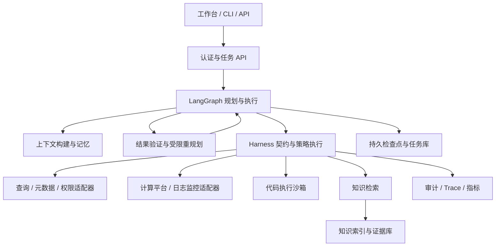

# Data Agent 大数据智能研发平台改进 PRD

| 属性 | 内容 |
| --- | --- |
| 版本 / 日期 | v3.0 / 2026-10-12 |
| 状态 | Draft，可用于需求评审与任务拆分 |
| 对应岗位 | AI Agent 工程师（大数据方向），T024781 |
| 改进对象 | 当前 data-agent 项目，基于本次工作区代码与已有文档分析 |
| 交付边界 | 本文为产品与工程改进需求；目标指标均为拟定验收门槛，非现有实测成绩 |
| 核心目标 | 将已有数据平台助手演进为可规划、可执行、可验证、可追踪的数据智能工作台 |

## 1. 产品定位与成功条件

面向数据分析师、数据研发和平台运维，统一完成“理解业务问题 → 找到可信数据与知识 → 制订计划 → 调用平台工具 → 验证结果 → 交付分析、SQL、代码或诊断报告”。沿用 Python、LangGraph、Pydantic 与现有平台适配器，重点补齐真实执行闭环和生产运行能力。

项目最终应能展示五类 Agent：数据分析、知识问答、SQL 开发、Coding、计算任务及查询故障排查。五类能力共享编排、工具、权限、上下文、记忆、评测和可观测性底座；无需为每类能力部署独立服务。

成功条件：五类场景均有可复现演示与独立验收集；至少接入一个真实 SQL 引擎及一个真实计算运行环境；能够展示断点恢复、越权拦截、故障定位、评测回归和发布回滚。只有经过实际用户试点与运行记录验证，才能声明具有生产落地成果。

## 2. 项目现状与差距

现状判断来自代码静态检查，未在本次文档任务中运行服务或测试。工作区存在进行中的源码修改及两份新增 PRD，本方案以当前可见内容为基线；实施前需重新冻结基线。

| 能力 | 当前可见实现与证据 | 本次改进 |
| --- | --- | --- |
| 工作流 | `graph.py` 有按意图进入固定节点的 StateGraph；`nodes.py` 有权限中断和续跑 | 增加跨意图任务计划、依赖管理、验证、有限重规划 |
| 工具 | `tooling.py` 注册 37 个工具并记录调用审计；`services.py` 定义平台协议 | 统一工具 Schema、策略、版本、限额、错误和幂等契约 |
| SQL / 查询 | 有解析、校验、优化、执行及结果解释节点 | 补自然语言到 SQL、真实方言验证、结果正确性验证 |
| 平台接入 | 有 InMemory 与 HTTP 适配器 | HTTP 接口存在不代表已完成真实平台联调，需提供集成证据 |
| 本地结果 | `adapters/memory.py` 查询返回预设结果；EXPLAIN 由本地规则模拟 | 本地演示结果明确标注，评测执行正确性使用真实引擎 |
| DAG | 有生成、校验、发布、触发、状态和回填流程；有 DAG mock 测试 | 接入真实任务状态、计算日志、指标、故障诊断与受控修复 |
| 模型能力 | LLM 配置和路由已存在；工具调用主要由节点代码组织 | 落实阶段受限的模型 Tool Calling，再扩展任务级规划 |
| RAG | 已有独立 RAG PRD；当前源码目录未见完整入库、向量检索与引用链 | 落实知识摄取、权限过滤、混合检索、证据回答与删除传播 |
| 会话 | 默认 `MemorySaver`，支持注入 checkpointer，状态保存消息和任务信息 | 持久化、租户隔离、上下文预算、长期记忆及失效管理 |
| 服务与安全 | HTTP 请求模型包含 `user_id`，下游透传 `X-User-Id` | 建立可信身份认证、会话归属校验和端到端授权，不能把身份字段当作认证 |
| 质量与运维 | 有图、路由、CLI、HTTP 等测试及工具审计 | 补 Agent 任务评测、分布式追踪、SLO、成本、灰度及恢复演练 |

### 2.1 与已有 PRD 的关系

- [PRD v2](../prd_v2.md)：保留资产、权限、审批、SQL 和查询等业务需求，作为现有能力基础。
- [模型工具调用 PRD](../prd_model_tool_calling.md)：作为本文 FR-06 的详细子规范。先执行其受限工具调用方案；本文规划器只组合预定义能力节点，不允许模型动态修改代码或任意图结构。
- [RAG PRD](../prd_rag.md)：作为本文 FR-02、FR-07 的详细子规范。本文增加跨 Agent 共享证据、统一评测和生产门槛。
- 本文的 M0–M5 表示总体里程碑，不等同于子 PRD 的 P0/P1/P2。发生范围冲突时记录评审结论，再更新相关文档，不能静默跳过原有安全约束。

## 3. 招聘要求逐项覆盖矩阵

| 招聘条目 | 产品与工程落点 | 可展示、可核验的交付物 |
| --- | --- | --- |
| 职责 1：数据分析 Agent | FR-01：指标澄清、分组分析、可复算报告 | 分析任务、SQL、数据快照引用、图表、正确性报告 |
| 职责 1：知识问答 Agent | FR-02：带权限和引用的 RAG | 入库流水线、知识版本、带引用回答、拒答案例 |
| 职责 1：SQL 开发 Agent | FR-03：Text-to-SQL、优化、验证 | 真实数据库执行记录、结果等价评测、优化前后对比 |
| 职责 1：Coding Agent | FR-04：数据处理代码生成、测试与修复 | 代码差异、沙箱测试、构建产物、失败修复轨迹 |
| 职责 1：计算任务及查询故障排查 Agent | FR-05：日志、指标、执行计划联合诊断 | Spark 任务与 SQL 查询故障报告、证据、修复验证 |
| 职责 2：架构、任务规划、工具调用、流程编排、多步骤执行 | FR-06：Planner、Executor、Verifier、受限重规划 | 任务依赖图、工具调用轨迹、中断与恢复演示 |
| 职责 3：查询、元数据、权限、计算、日志监控、代码执行工具 | FR-07：六类平台工具与统一契约 | 工具目录、Schema、权限矩阵、适配器契约测试 |
| 职责 4：RAG、上下文、记忆、评估、可观测性 | FR-02、FR-08、FR-09 | 检索评测、上下文消融、记忆删除、Trace、评测看板 |
| 任职 1：数据结构、算法、数据库、网络、分布式系统 | 第 9 节工程设计与专项验证 | DAG 判环、检索融合、查询计划、重试与幂等、故障注入报告 |
| 任职 2：至少一种语言、软件工程、系统设计 | Python 主语言；第 8–10 节 | 类型契约、模块边界、单元/契约/集成测试、架构决策记录 |
| 任职 3：LLM / Agent、RAG、Tool Calling、Workflow、Context Engineering | FR-02、FR-06、FR-08 | 从知识检索到多步骤执行的完整可运行链路 |
| 任职 4：问题分析、工程落地、稳定生产系统 | FR-05、FR-09、NFR、第 12 节 | 根因分析、负载与恢复报告、试点、灰度和回滚记录 |
| 加分 1：生产级 Agent、Data Agent、Text-to-SQL、Coding Agent | 五类场景 + M5 生产试点 | 实际运行证据；演示环境和生产数据分别标注 |
| 加分 2：Agent Evaluation、LLMOps、向量检索、搜索、沙箱 | FR-02、FR-04、FR-09 | 固定评测集、版本管理、检索对照实验、隔离攻击测试 |
| 加分 3：数据分析、SQL Agent、大数据平台智能化 | FR-01、FR-03、FR-05 | 从指标分析到 Spark 作业排障的业务闭环 |

## 4. 用户、范围与优先级

| 用户 | 核心任务 | 成功体验 |
| --- | --- | --- |
| 数据分析师 | “上周华东 GMV 为什么下降？” | 确认口径和时间后获得可复算的分解分析 |
| 数据研发 | “按客户和日期汇总退款，生成 SQL 与 PySpark 作业。” | 获得经验证的 SQL、代码和测试结果 |
| 平台运维 | “这个任务为什么失败，这条查询为什么变慢？” | 获得与日志和指标关联的诊断及处置建议 |
| 业务用户 | “GMV 是否包含退款，应该查什么表？” | 获得带来源、版本与适用范围的回答 |
| 平台管理员 | 接入工具、知识源和用户；观察质量与成本 | 能定位失败步骤、回滚版本、管理访问范围 |

首个可用版本覆盖身份与工具底座、知识问答、SQL 生成及单任务持久化。随后完成分析、Coding 和排障，最后验证生产运行。全部岗位点在完整路线中覆盖，不能仅交付首期就宣称全部达标。

暂不纳入通用 IDE 替代、自建大数据计算引擎、多语言 Agent 服务重写、模型训练及无人审批的生产写操作。平台任务可执行受控数据写入，但必须走独立发布权限、审批、环境与资源配额流程；交互式查询入口继续只读。

## 5. 核心用户旅程与交互

### 5.1 一次完整分析

1. 用户提出“分析上周华东 GMV 下降原因”。系统询问必要的业务口径、时区及比较周期，将相对日期转换为明确区间。
2. 展示简短计划：核实指标 → 查表及权限 → 生成 SQL → 检查成本 → 执行 → 按地区、渠道分解 → 验证 → 输出。
3. 检索指标说明并以平台实时定义核实；权限不足时衔接既有申请流程，批准后重新校验权限。
4. 低风险查询在预算内执行；超预算时展示扫描量、费用或运行时长估计，要求确认或缩小范围。
5. 返回摘要、表格/图表、指标口径、SQL、query_id、数据时间和分析限制。区分“观察到的贡献因素”与“尚未验证的因果解释”。
6. 用户追问“只看新客”，生成新任务版本，继承已确认口径和数据引用，重新校验适用权限和查询范围。

### 5.2 工作台最小界面

提供对话区、步骤进度、结果区、待确认卡片和历史任务。SQL 展示代码与执行状态；代码任务展示差异与测试；知识回答展示引用；诊断展示证据时间线。错误应指出失败步骤、可保留成果和下一步操作。

任务状态统一为 `queued / planning / running / waiting_user / waiting_approval / verifying / succeeded / partial / failed / cancel_requested / cancelled`。取消请求与平台已取消必须区分；刷新页面或服务重启后可继续查看任务。面向用户展示行动摘要与证据，不输出模型内部思维链。

## 6. 功能需求

### FR-01 数据分析 Agent

- 输入业务目标、指标、维度、时间区间、比较基准和过滤条件；口径不明确时先澄清。
- 支持趋势、同比环比、维度贡献分解、异常点解释和逐层下钻；计算由 SQL 或沙箱完成。
- 校验表粒度、JOIN 基数、金额单位、时区、去重、NULL、空集、分母为零和分区完整性。总量与分组聚合需可对账。
- 输出结论、图表、查询与计算依据、数据新鲜度及局限；样本推断必须标明抽样范围。
- 验收：固定 40 个分析任务，至少 85% 满足全部任务断言；金额按最小货币单位核对，比例误差不超过 0.1 个百分点；报告中的数值均可追溯到计算产物。

### FR-02 知识问答与 RAG

- 建立文档摄取、清洗、按结构切片、Embedding、索引、更新删除链路；支持平台指南、指标说明、数据字典、运行手册和审核 SQL 样例。
- chunk 必须记录文档/版本/位置、业务域、更新时间、租户、ACL 和内容哈希；索引版本可追踪。
- 支持精确标识符、关键词与向量召回，使用可配置的融合策略；重排序由检索评测决定是否启用。
- 检索前按租户与 ACL 限制候选，返回及生成前复查；撤权后立即拒绝读取，索引与缓存清理目标为 5 分钟内完成。
- 回答带可访问的来源及版本；无证据、冲突、过期时说明限制或询问范围。权限状态、表结构等实时事实通过平台工具确认。
- 文档中的“忽略规则”“调用工具”等内容仅作为资料，不改变系统策略。
- 验收：100 个有答案问题 Recall@5 ≥ 85%、引用支持率 ≥ 95%；30 个无答案/冲突问题正确处理率 ≥ 90%；另设 ACL 与注入测试且必须全部通过。

### FR-03 SQL 开发 Agent / Text-to-SQL

- 完成需求澄清、Schema Linking、指标绑定、SQL 生成、方言解析、权限检查、EXPLAIN、执行及验证。生成与执行是不同状态。
- 首期真实 SQL 引擎选 PostgreSQL；随后以 Spark SQL 展示大数据场景。现有 HTTP 适配器继续用于企业平台接入，新增能力通过适配器声明。
- 建立字段、表、关联键和指标的可追踪映射；无法确认字段和 JOIN 关系时停止生成确定性答案。
- SQL 在 AST 层执行单语句、只读、对象及函数限制，数据库执行账号再次限制权限；不能仅靠关键词正则防护。
- 提供超时、结果行数、扫描预算和查询取消。SQL 语法/字段纠错最多 2 次，每次记录错误与差异；权限拒绝不得通过改写绕过。
- 优化建议区分数据库索引与大数据分区裁剪、JOIN、Shuffle、倾斜治理；重写必须验证结果等价，不能仅比较耗时。
- 验收：100 题固定业务测试集执行结果正确率 ≥ 85%；按任务声明顺序语义，集合比较保留重复行；数值精度单独配置。优化集至少 20 例全部结果等价，并记录相同快照及资源条件下的耗时与扫描量，不承诺普遍提速。

### FR-04 Coding Agent 与代码执行沙箱

- 面向 Python/PySpark 数据清洗、转换、校验和作业脚本，支持读取授权工作区、生成补丁、生成测试、执行测试及有限修复。
- 流程为需求与样例确认 → 读取有限上下文 → 生成代码差异 → 静态检查 → 沙箱测试 → 最多 2 次修复 → 返回产物。发布生产作业必须单独确认。
- 沙箱使用隔离运行环境：非特权用户、只读基础镜像、临时目录、CPU/内存/时间/进程/输出限制，默认禁止外网与宿主挂载，不提供宿主容器管理 socket。
- 演示默认每任务 2 vCPU、2 GiB、60 秒，可配置；Spark 集成作业使用另设配额。依赖使用批准镜像或白名单，禁止任意安装脚本。
- 仅挂载经过授权的样本和文件；路径穿越、符号链接越界、密钥读取、跨任务访问必须阻断；超时销毁子进程并清理临时文件。
- 输出代码、依赖版本、输入输出 Schema、测试摘要和可下载产物；模型生成测试之外，必须执行独立维护的业务测试。
- 验收：40 个数据处理任务 pass@1 ≥ 60%、最多两次修复后成功率 ≥ 80%；隔离测试全部通过。容器演示隔离不自动等于可运行任意不可信代码的生产安全结论。

### FR-05 计算任务及查询故障排查 Agent

- 输入 job_id、query_id 或告警，获取任务状态、执行计划、日志、指标、数据血缘及近期变更；有权限的资料才可进入上下文。
- 查询问题覆盖语法/字段错误、无权限、超时、资源排队、全表扫描与 JOIN 膨胀；Spark 覆盖 OOM、数据倾斜、Shuffle 异常、分区缺失和上游依赖失败。
- 输出“现象 → 已证实事实 → 根因候选与证据 → 排除项 → 建议 → 验证步骤”。置信度用已校准的等级表达，不能仅凭模型自评分确定根因。
- 不能获取关键日志时返回证据不足；根据同一 trace 和时间窗口关联指标，避免把不同执行实例混为一谈。
- 重跑、回填、调参和发布先展示参数差异、资源估计、影响范围、回滚或补偿办法，经审批后执行。以新运行的状态和指标验证修复结果。
- 验收：40 个独立故障案例（计算与查询各 20），Top-1 根因准确率 ≥ 75%、Top-3 ≥ 90%；包含真实运行采集和标注回放并分别统计，不能全部依赖 mock；无证据时不得报告“已修复”。

### FR-06 任务规划、编排与多步骤执行

- 规划器输出结构化 Plan：目标、输入、步骤、依赖、工具/能力类别、前置条件、产物、验证规则、预算和审批点。
- 短任务复用固定节点；复杂任务采用 Plan → Execute → Verify，失败时最多重规划 2 次。计划默认最多 12 步、30 次工具调用，超限转用户决策或终止。
- 规划器只能组合注册能力节点。服务端验证计划无环、依赖存在、参数引用合法、工具阶段允许、预算及权限满足。
- 无依赖只读步骤可有限并行；副作用操作按依赖顺序执行。步骤失败时保留成功产物，禁止把局部成功渲染为全部完成。
- 检查点保存步骤状态和外部执行 ID，恢复时先核对外部状态。用户修改 SQL、资源、环境、代码或回填区间后，旧确认失效。
- 验收：30 个跨能力任务成功率 ≥ 80%；循环、缺失依赖、未知工具、超预算全部被拦截；在提交前后和确认前后注入中断，可恢复且无重复副作用。

### FR-07 标准化工具体系

工具统一通过 Harness 校验再执行。新增可选能力注册机制，避免给平台新增一种工具就要求所有旧适配器立即实现；启动时校验启用流程的必需能力。

| 类别 | 复用/新增工具示例 | 最低契约 |
| --- | --- | --- |
| 数据查询 | 复用 execute_query/get_query_status/get_query_result/cancel_query | 方言、超时、分页、扫描预算、查询 ID |
| 元数据 | 复用表/字段/指标/血缘工具 | 实时版本、粒度、数据类型、访问范围 |
| 权限 | 复用 check_permission/create_permission_ticket | 可信身份、环境、资源、动作、审批快照 |
| 计算平台 | 复用 DAG 工具；新增 get_job_status/get_job_metrics | 平台运行 ID、幂等键、资源预算、状态映射 |
| 日志监控 | 新增 search_logs/get_query_profile/get_alert | 时间窗口、过滤范围、分页、脱敏、数据来源 |
| 代码执行 | 新增 create_sandbox/run_code/run_tests/get_artifacts | 镜像、配额、文件范围、退出码、产物引用 |
| 知识检索 | 新增 search_knowledge/get_evidence | ACL、文档版本、位置、召回分数与证据 ID |

每个工具定义 `name/version/description/input_schema/output_schema/risk_level/required_permissions/timeout/retry_policy/idempotency/cost_hint`。服务端注入租户、用户、会话、任务和 trace，模型不得覆盖。输入拒绝额外字段，输出也验证结构；结果使用 `status/data/error/retryable/source_version`，区分无数据、无权限、超时和平台失败。

验收：启用工具 100% 具有契约与权限声明；模型调用与固定节点调用共用策略入口；错误类型和适配器行为有契约测试；审计覆盖成功、拒绝、异常和超时，每次执行具有唯一事件 ID。

### FR-08 Context Engineering 与记忆

- 区分任务结构化状态、近期消息、证据引用和长期记忆。查询大结果保存到受控产物存储，仅将必要聚合/样本加入上下文。
- Context Builder 按当前任务选取工具 Schema、指标定义、计划、错误及证据；为输出预留窗口，超预算先裁剪低相关信息再摘要。
- 上下文压缩保留目标、已确认条件、待办、失败原因和证据 ID，不改变 SQL、权限快照及人工确认等事实状态。
- 长期记忆仅保存用户明确确认的偏好、审核案例和可复用规则，记录主体、来源、版本、TTL、可见范围，提供查看、更正、删除；不默认保存原始敏感数据。
- 每次召回重新检查权限；撤权后旧记忆和旧查询产物不能继续泄漏内容。权限结论不能作为永久记忆使用。
- 验收：20 组至少 30 轮对话保持关键约束正确率 ≥ 95%；在同一任务集上，对照全历史方案目标降低输入 Token ≥ 30%，任务成功率下降不超过 2 个百分点；隔离、撤权与删除测试全部通过。

### FR-09 Agent Evaluation、LLMOps 与可观测性

- 评测分为工具契约、检索、回答、任务结果、安全、故障恢复和性能成本。评测报告同时提供聚合指标与分类失败案例。
- 统一记录数据集、模型、Prompt、工具、代码、索引和配置版本。上线前固定回归集，修改模型或检索策略必须重跑相关集。
- 每个任务建立 Trace；Span 覆盖路由、检索、模型调用、工具、审批等待、执行、验证。记录耗时、Token、费用估算、重试与错误类型，日志默认脱敏。
- 看板展示任务成功率、工具失败率、P95 延迟、排队时长、成本、无依据回答、恢复失败和安全拒绝。基础设施错误与正常权限拒绝分开统计。
- 用户反馈生成经脱敏审核的 bad case，加入未来回归集；线上真实写操作不用于自动回放。
- 发布包绑定上述版本，支持影子评测、5% → 25% → 100% 灰度与回滚；影子流量禁用副作用工具。
- 验收：测试任务 100% 可由 task_id 找到 Trace、版本与证据；关键 Span 完整率 ≥ 99%；人为注入工具超时后 5 分钟内告警；可通过回放定位错误层并验证修复。

## 7. 非功能需求与安全门槛

下表为试点目标，需在 M0 冻结硬件、模型版本、外部依赖、请求比例及负载脚本。分别报告 Agent 自身开销与包含模型/平台等待的端到端耗时。

| 维度 | 要求及验收口径 |
| --- | --- |
| 身份与隔离 | 从可信认证生成 principal，校验 tenant/user/session/task/result 的归属；任何外部请求体中的身份不能直接成为可信凭证 |
| 授权 | 检索、元数据、查询、日志、代码、审批及产物下载分别鉴权；平台侧实施行列权限与脱敏；服务不可用时不默认放行 |
| SQL / 沙箱安全 | 只读账号 + AST 检查 + 执行配额；代码与主服务隔离；提示注入不影响策略决策 |
| 可用性 | 试点连续 14 天，任务 API 非业务失败请求可用率 ≥ 99.5%；同时报告端到端任务成功率 |
| 性能 | 20 个活跃会话、最多 5 个执行任务条件下，异步受理 P95 ≤ 1 秒；知识回答 P95 ≤ 15 秒；长任务 2 秒内返回任务 ID |
| 资源控制 | 队列上限、租户限额、执行并发、模型 Token、查询扫描量、代码配额均可配置；饱和返回明确限流状态 |
| 恢复 | 已提交到持久存储的检查点进程崩溃后不丢失；节点重启恢复目标 ≤ 60 秒；存储灾难场景 RPO ≤ 24 小时、RTO ≤ 1 小时，备份恢复演练验证 |
| 成本 | M0 基线后按任务类型确定预算 B；至少 95% 成功任务成本 ≤ 对应 B，超预算停止或请求确认；费用估算标明计价版本 |
| 审计与隐私 | 身份、策略、确认、外部执行 ID 完整留痕；敏感内容脱敏，日志与产物保留期可配置，演示默认 30 天 |

零越权、零重复副作用是验收集门槛，不构成对所有未知输入的绝对保证。安全用例任一失败均阻止发布，不能用总体成功率抵消。

## 8. 目标架构与代码改造

采用模块化单体承载 API 和业务编排，执行 Worker、计算平台与沙箱独立运行。建议 PostgreSQL 保存任务、检查点和知识元数据；早期通过扩展支持向量与文本检索，是否增加独立搜索服务由检索规模和压测决定。产物保存到对象存储或本地兼容实现，访问统一鉴权。

| 现有位置 | 改造方向 | 拟新增模块 |
| --- | --- | --- |
| `graph.py` / `state.py` | 加入计划、步骤、恢复、验证状态；接入持久化 | `orchestration/`、`persistence/` |
| `nodes.py` | 按分析、SQL、知识、Coding、诊断拆出领域节点，保留现有入口兼容 | `agents/` |
| `tooling.py` / `api_contracts.py` | 工具定义、Schema、策略、预算、错误、幂等 | `tools/`、`security/` |
| `services.py` / `adapters/` | 声明可选平台能力；添加真实查询、计算和日志接入 | 新适配器与契约测试 |
| `routing.py` / `llm.py` / `prompts.py` | 五类任务路由、规划及调用模型配置、版本与降级 | `context/`、`memory/` |
| `formatting.py` / `http_server.py` | 结构化产物、异步任务、进度、可信认证 | `api/`、最小工作台 |
| 当前无对应独立模块 | 摄取、检索、证据；沙箱；评测与观测 | `rag/`、`sandbox/`、`evals/`、`observability/` |

这些路径是实施建议，不代表本次创建了对应代码。先建立兼容与回归检查，再逐步迁移，避免一次重写所有现有流程。

### 8.1 核心数据与接口

| 实体 | 必需字段或约束 |
| --- | --- |
| Task / Plan / Step | tenant、user、session、task、plan_version、step_id、依赖、状态、输入/输出引用、预算、重试次数、验证结果 |
| ToolInvocation | invocation_id、工具版本、参数摘要、策略结果、幂等键、外部 ID、状态、错误与 trace |
| Evidence / Artifact | 来源、版本、查询/作业 ID、快照时间、内容哈希、ACL、过期时间、受控存储位置 |
| Approval | 审批主体、操作和参数哈希、计划版本、有效期、决定；关键参数变更必须重审 |
| Memory | 主体范围、类型、内容引用、来源、审核状态、TTL、版本、撤回状态 |
| EvaluationRun | 数据集/模型/Prompt/工具/索引/代码版本、配置、结果、成本及失败样本 |

新增 `POST /tasks`、`GET /tasks/{id}`、`GET /tasks/{id}/events`、`POST /tasks/{id}/resume`、`POST /tasks/{id}/cancel`、`GET /artifacts/{id}`；历史聊天入口作为兼容层。异步创建返回 202 和 task_id；resume 要求步骤/计划版本、服务端确认凭据和幂等键；所有查询及下载接口检查归属。错误返回稳定 error_code、retryable 与 trace_id。

## 9. 计算机基础与系统设计的工程体现

| 基础能力 | 必须实现或解释的机制 | 验证方式 |
| --- | --- | --- |
| 数据结构 | 任务依赖邻接表、就绪队列、基于键的工具注册表、缓存及过期索引 | 大型计划正确执行，非法引用和循环拒绝；说明空间增长 |
| 算法 | DAG 拓扑排序与判环 O(V+E)；Top-K 召回融合；有限重试与预算调度 | 计划边界测试、检索离线对照、避免无限执行 |
| 数据库 | 事务更新任务、唯一幂等键、检查点、执行计划、JOIN 与分区；SQL 方言隔离 | 并发状态竞争、结果等价、索引/分区优化实验 |
| 网络 | 连接池、认证、超时、状态码、429/5xx 重试、退避与抖动、断流恢复 | 注入超时、连接失败、限流和断开事件流 |
| 分布式系统 | 至少一次投递、幂等消费、Worker 租约、心跳、过期接管与 fencing token | Worker 崩溃与旧 Worker 回归，不允许重复提交或覆盖新状态 |
| 软件工程 | Python 类型与 Schema、领域接口、依赖注入、兼容适配器、CI、版本迁移 | 单元/契约/集成/端到端分层检查、架构决策记录 |

外部提交与本地状态保存不能假设原子完成：先持久化调用意图及幂等键，再提交并记录平台执行 ID。超时后通过幂等键或平台查询对账；平台既不支持去重也无法查询时转人工核查，禁止盲目重发。涉及不可回滚的数据写入时，提前明确补偿方案和审批边界。

## 10. 评测数据、指标与验收方法

开发集、调参集和最终测试集按业务问题模板、数据版本或故障来源划分，避免同一 SQL 改写后同时进入训练样例与测试集。最终验收固定模型配置，各任务运行 3 次，报告均值、最差一次及样本量；不可挑选最好结果。安全用例每次均需通过。

| 测试集 | 最低规模 | 主验收指标 |
| --- | --- | --- |
| RAG | 100 有答案 + 30 无答案/冲突 | FR-02 检索、引用和正确处理门槛 |
| Text-to-SQL | 100 题 + 20 优化案例 | 执行结果正确率、结果等价性 |
| 数据分析 | 40 题 | 任务完整正确率、数值一致、证据覆盖 |
| Coding | 40 题，含独立隐藏业务测试 | 首次通过率和有限修复成功率 |
| 排障 | 40 例，计算/查询各半 | Top-1/Top-3、证据一致性、修复验证 |
| 编排 / 上下文 | 30 个复合任务 + 20 组长对话 | 成功率、恢复、关键约束、Token 成本 |
| 安全与故障注入 | 至少 60 例 | 越权、注入、危险 SQL、沙箱逃逸尝试、重复提交、崩溃恢复全部通过 |

任务成功率的分母为全部有效任务；超时、错误结果和不当拒绝计失败，只有标注要求澄清或拒绝的案例才将对应行为记为成功。工具成功率按调用次数统计，另报按任务聚合结果，不能用大量简单调用掩盖任务失败。Recall@5 以人工标注可支持答案的证据集合计算；引用支持率按被引用的事实断言核查。

自动评测优先采用 SQL 结果、程序测试、状态机和证据检查；需要模型裁判的语义评分，固定评分标准并人工复核至少 20% 和全部争议样本。成本包含所有重试，延迟按任务类型分层报告。

验收产物包含原始结果、数据版本、运行命令、配置、汇总报告和失败分析。业务指标如“节省分析时间”使用同一任务的人工作业基线对比；没有实际测量时不填写提升百分比。

## 11. 分阶段交付与依赖

以下为一名熟悉 Python 的开发者、每周投入约 25–30 小时、拥有可用模型和测试平台情况下的 14–18 周粗估。真实平台接入及安全评审可能延长周期；M0 完成后重估。每期包含功能、文档、评测和演示。

| 阶段 | 估计周期 | 可交付结果 | 退出门槛 |
| --- | --- | --- | --- |
| M0 基线与接入准备 | 1 周 | 能重现当前权限/查询闭环；冻结版本、数据、模型与指标 | 现有回归结果记录，真实 SQL/计算环境接入方案、初始评测集和预算获确认 |
| M1 可信工具与 SQL MVP | 2–3 周 | 用户可安全生成并执行只读 SQL；任务可重启恢复 | FR-03 首期 PostgreSQL 验收，身份、工具契约、幂等与隔离门槛通过 |
| M2 知识与上下文 | 2–3 周 | 平台知识问答、引用、可控记忆和长对话 | FR-02、FR-08 验收及撤权/删除传播通过 |
| M3 复合分析 | 3 周 | 自动计划、跨工具执行、图表与报告 | FR-01、FR-06 验收；分析口径与数值可复算 |
| M4 Coding 与大数据排障 | 4–5 周 | PySpark 代码在沙箱测试；真实计算/查询排障 | FR-04、FR-05；Spark SQL 集成；真实运行证据和隔离测试通过 |
| M5 生产运行验证 | 2–3 周 | 完整工作台、灰度试点、看板、告警与回滚 | 全矩阵覆盖、NFR 负载/恢复检查、14 天试点报告及发布评审 |

观测、权限和评测从 M1 开始随功能交付；M5 汇总验证，不能在功能完成后才补这些底座。M2、M3 依赖 M1；M4 的 Coding 依赖工具与沙箱，排障依赖真实平台和日志；M5 依赖全部功能验收。

可直接拆为本地实施任务包：可信身份与持久状态；工具契约和策略；SQL 生成与验证；知识摄取与检索；上下文与记忆；规划与数据分析；沙箱与 Coding；Spark/日志接入与排障；评测与版本管理；工作台、部署与试点。每包都提交需求对应关系、测试证据和演示脚本。

## 12. 发布、风险与待决事项

### 12.1 发布与降级

每类 Agent、模型工具调用、RAG、记忆和自动重规划均有独立开关。新增功能先在测试环境和只读流量验证，按灰度比例扩大。模型或检索异常可回到现有固定流程或明确返回暂不可完成；不能编造查询结果、引用或执行成功。

出现越权、重复副作用立即暂停对应能力并回滚；普通错误率相对基线上升超过 5 个百分点或任务 P95 持续 10 分钟超过预算 2 倍时停止放量。回滚模型/Prompt/工具/索引配置必须保持版本兼容；已在执行的外部任务先对账，再决定继续或取消。数据库迁移采用兼容扩展与独立回退方案，不能仅回退应用镜像。

### 12.2 主要风险

| 风险 | 应对及降级边界 |
| --- | --- |
| 范围过大 | 先让 SQL 与知识可用，按阶段完成五类场景；以验收结果确定完成范围 |
| 指标口径错误、表粒度不一致 | 语义定义版本化、澄清、基数检查、结果对账及人工业务复核 |
| 测试环境无法代表生产 | 区分模拟、真实集成和试点；报告数据量、硬件、并发及依赖版本 |
| 多轮规划成本与延迟失控 | 有限步数、调用预算、缓存、并发上限与强制终止 |
| 知识过期与敏感信息泄漏 | 实时事实核实、ACL 复查、撤权同步、日志脱敏及保留策略 |
| 沙箱隔离不足 | 独立运行环境、资源与网络限制、攻击测试；未过隔离评审前只接可信演示代码 |
| 故障修复引入二次影响 | 明确证据、参数差异、审批、测试环境验证、生产补偿方案 |

### 12.3 待确认项及默认假设

1. 是否有真实数据平台、统一身份系统、Spark 与日志接口？默认提供本地可复现环境；无真实接口则暂不能通过生产接入验收。
2. 首个业务域及指标负责人？默认订单、退款、GMV，采用合成数据；真实指标由业务负责人确认。
3. 模型部署与数据出域要求？默认经组织批准的模型服务；在确定前不发送企业敏感数据。
4. 预算、硬件及工作量投入？采用第 7、11 节假设，M0 实测后固化配置和排期。
5. 生产写入、重跑、回填审批主体及可回滚范围？默认受控测试环境，生产动作需平台侧明确授权和确认。

这些问题不阻止方案评审与本地开发，但必须在对应平台接入和发布前落实。

## 13. 最终验收与项目展示清单

- 五个录屏或演示脚本：指标分析、带引用问答、自然语言 SQL、代码生成与修复、计算任务和查询故障诊断。
- 一条跨场景链路：查指标定义 → 生成 SQL → 分析异常 → 定位上游任务 → 生成修复代码 → 沙箱验证 → 审批后测试环境重跑。
- 架构图、工具目录、权限模型、任务状态机、关键设计取舍与部署/恢复手册。
- 固定评测集及报告、真实引擎/计算日志、Trace 和成本看板、失败案例修复记录。
- 生产试点的参与用户、时间区间、任务量、可用率和业务收益；没有生产运行时，将项目描述为“具备生产化设计并完成集成验证”，不得虚构生产经历。

所有岗位条目都需能从第 3 节追踪到实现、测试与演示证据。功能数量之外，评审重点是结果是否正确、过程能否解释、失败能否恢复，以及权限和资源是否受到可靠控制。
